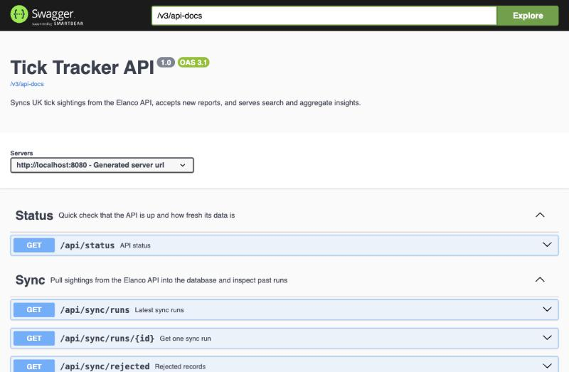
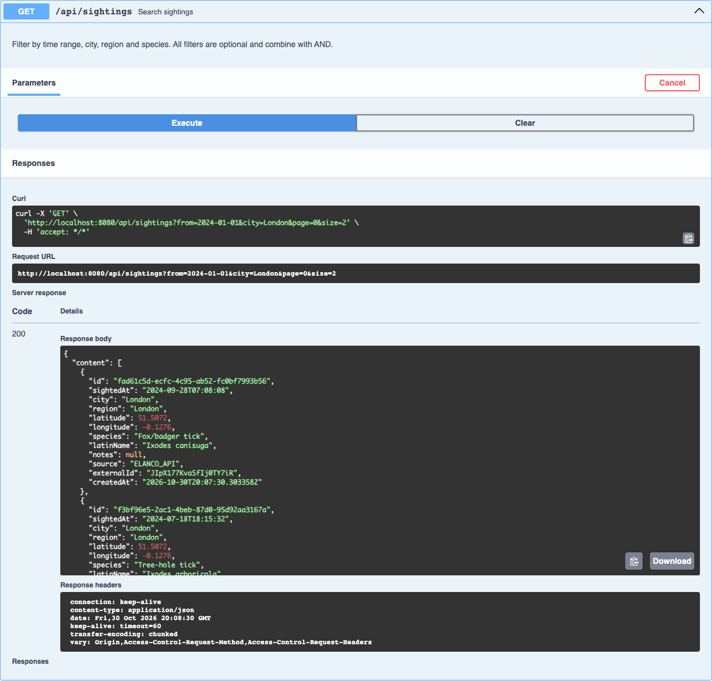
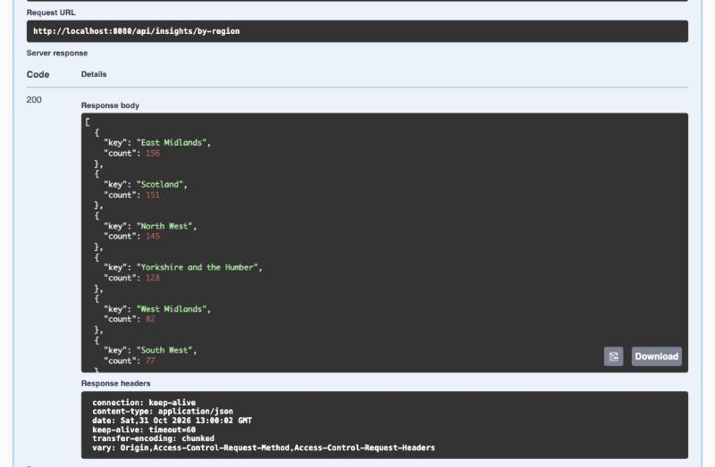
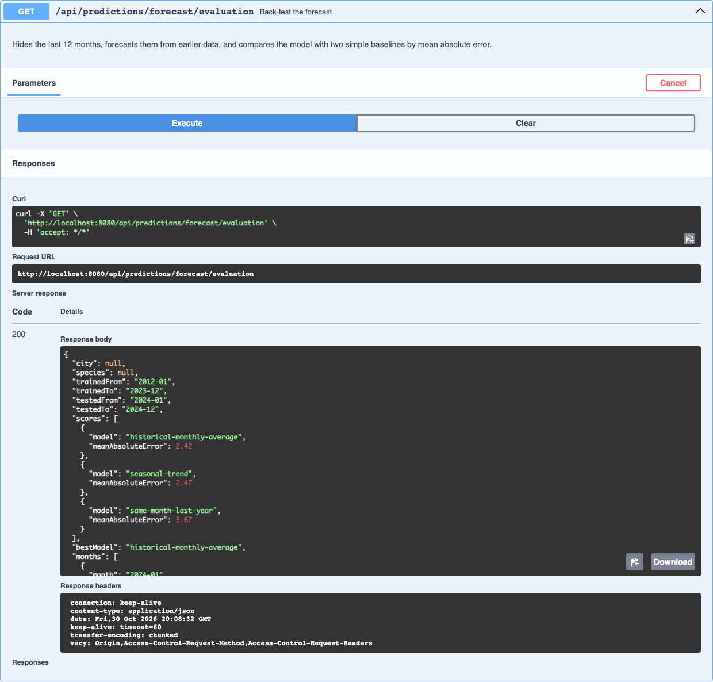

# Architecture

This document covers how the Tick Tracker API gets its data, how it serves it, and the decisions and trade-offs behind both. For how to run it and the full endpoint list, see the [README](../README.md).

## Overview

```
                      every 6 hours, on startup, or POST /api/sync (202 + run id)
                                          │
  Elanco API ──HTTP──► ElancoClient ──────┘
  (1000 records,       timeouts; retry on 429 / 5xx / network errors;
   one JSON array)     backoff 5s→60s over 5 attempts, or Retry-After
                           │
                           ▼  each record parsed on its own
                     SightingNormalizer ──► Accepted (cleaned, + corrections)
                           │            └─► Rejected (reason)
                           ▼
                     IngestionService
                       de-dupe within the batch and against the DB
                       (external id + content hash), insert in chunks of 500,
                       one sync at a time (AtomicBoolean → 409)
                           │
          ┌────────────────┼───────────────────────┐
          ▼                ▼                       ▼
     sightings      rejected_records          sync_runs
          │         (raw JSON + reason)   (counts, status, error)
          │                ▲                       ▲
  POST /api/sightings      │                       │
  (user reports, same      └────── /api/sync ──────┘
   table, 409 if duplicate)
          │
          ▼
   PostgreSQL 16 (schema owned by Flyway; Hibernate only validates)
          │
          ├── SightingService (JPA Specifications) ──► /api/sightings
          ├── InsightsService (plain SQL) ───────────► /api/insights/*
          └── PredictionService (Java on the monthly trend from InsightsService) ──► /api/predictions/*

  Every error ──► GlobalExceptionHandler ──► one ApiError JSON shape
```

## How data comes in

1. **Trigger.** A sync starts when the app starts, every 6 hours on a cron schedule, or by hand. The manual `POST /api/sync` returns 202 with a run id at once and runs the sync on a background thread, and the caller polls `GET /api/sync/runs/{id}`.
2. **Record the run first.** A `sync_runs` row is created as RUNNING before anything is fetched, so a failed run is recorded too.
3. **Fetch.** `ElancoClient` downloads the whole list (the API has no paging). If it still fails after 5 attempts, the run is marked FAILED with the reason, and the stored data stays as it was.
4. **Normalise.** Each element of the JSON array is converted separately. A record is accepted (possibly with corrections) or rejected with a reason.
5. **De-duplicate.** Records are checked against the others in the same batch, then against the database in chunks of 500, by external id and by content hash.
6. **Write.** New sightings are inserted in chunks of 500 and rejects go to `rejected_records`. The run is marked SUCCESS with fetched, inserted, duplicates, rejected and corrected counts.

User reports through `POST /api/sightings` go through the same validation and the same content hash, so a report that repeats a synced sighting gets a 409.

## How data goes out

- **Search** builds a JPA Specification from the optional filters (date range, city, region, species) and returns my own page record, not Spring's `Page`, so the JSON shape is under my control.
- **Insights** are SQL queries through `NamedParameterJdbcTemplate`. Grouping, `date_trunc` for week, month and year, and `generate_series` for zero-filling all happen in Postgres. Search and insights share one filter parser, so a filter means the same thing everywhere.
- **Predictions** reuse the zero-filled monthly trend from `InsightsService`, and the statistics (seasonal profile, linear trend, back-test, Poisson tests, Benjamini-Hochberg) are plain Java. Each response includes a `method` and a `caveat` field in plain English.
- **Swagger UI** is generated from the controllers, so the endpoints and parameters always match the code, and it is the way to explore the API. There is no frontend.

## Key decisions and trade-offs

### 1. Sync into my own database instead of proxying

The Elanco API is rate-limited, returns everything in one array, can't filter by date and can't aggregate. With a local copy, the API keeps answering when Elanco is down, filters and aggregates run on indexed columns, and cleaning happens once at ingest instead of on every request. User reports also need a home, and keeping both sources in one table makes every query cover both.

*Trade-off:* data can be up to 6 hours old, and I store a copy of someone else's data. For sightings that change rarely, this is a good deal, and a manual sync is there when freshness matters.

### 2. Retries, backoff and failing safely

I saw real 429s while exploring the API (8 of 25 rapid requests on one check). The client retries on 429, 5xx and network errors with exponential backoff (5s, 10s, 20s, 40s, capped at 60s), over 5 attempts and about 75 seconds in total. The API doesn't document its rate limit, so I chose a total wait of about 75 seconds to cover a typical one-minute window. If the server sends `Retry-After`, that is used instead. Other 4xx errors fail at once, because retrying won't change the answer. Sleeping goes through a small `Sleeper` interface so the tests run instantly.

*Trade-off:* a failing sync holds a background thread for over a minute. That's acceptable because it runs off the request thread and only one sync can run at a time.

### 3. Correct, reject, and keep the rejects

The rule I used: fix something only if there's exactly one right answer. Wrong case or spacing, a timezone offset, a date with no time, or a missing latin name when the common name is known can all be fixed safely. Everything else is rejected: a missing, unparseable or future date, an unknown city or species, or a common and latin name that disagree. Rejects are stored with their raw JSON and reason, and they can be read through `GET /api/sync/rejected`.

*Trade-off:* rejecting is strict. A record with a new city name is lost to the stats until the reference data is updated. But the reject table makes this visible instead of silent.

### 4. De-duplication by external id and content hash

The external id catches the same record on every sync. The content hash, a SHA-256 of date, city and species in lower case, catches the same sighting under a different id or a blank id, and user reports that repeat a synced record. Both columns are unique in the database, so even a bug in the Java check can't insert a duplicate.

*Trade-off:* two genuinely different sightings of the same species in the same city at the same second would count as one. With timestamps to the second, I judged that very unlikely.

### 5. A city reference table because there are no coordinates

The feed only has a city name. An enum of the 14 known cities holds each one's region and coordinates. That gives a region filter for free, allows case-insensitive matching (including "Newcastle upon Tyne"), and gives a clear reason to reject unknown locations.

*Trade-off:* every sighting in a city gets the same coordinates, so nothing finer than city level is possible, and adding a city needs a code change.

### 6. Aggregations in SQL

Grouping 1000 rows in Java would work, but SQL is shorter, uses the indexes, and still works at a million rows. `generate_series` fills empty weeks or months with 0, so trend charts don't skip time, and the series covers the requested `from` to `to` range. The interval comes from an enum, never from raw user input, and a series is capped at 2000 periods.

*Trade-off:* the SQL is Postgres-specific, so the tests that cover it run against a real Postgres in Testcontainers rather than H2.

### 7. One error format

Everything goes through `GlobalExceptionHandler`. Validation problems are a 400 with one entry per field, and a body that isn't valid JSON is a 400 "Malformed request body". Then 404 is for a missing resource and 409 for a duplicate report or a sync already running. Anything unexpected is logged in full and returns a generic 500 with no internal details.

### 8. Honest predictions

I added a forecast and anomaly detection, but evaluated both before trusting them. The forecast is back-tested on the last 12 months against two baselines, and on this data the simple historical monthly average wins (MAE 2.42 against 2.47 for my model), so the API says so. Anomaly detection runs thousands of Poisson tests, so it corrects with Benjamini-Hochberg: 58 city-months have a raw p below 0.05, which is within what chance alone could produce (up to about 108), and none survive the correction. Building something that reports "no signal" felt more useful than something that invents one.

## Screenshots

Swagger UI, with every endpoint grouped by area:



A search for London sightings since 2024, with page size 2:



Sightings per region:



The forecast back-test, where the simple baseline beats my model:



## What I'd improve with more time

- **Authentication on the sync endpoints**, so that only an admin can trigger syncs or read rejects.
- **Real coordinates and PostGIS**, for distance queries instead of city-level locations.
- **Caching insight responses**, cleared after each successful sync.
- **Incremental sync** (only new records) if the source API ever supports it.
- **Image upload with object storage.** I'd check the file's real type and keep only the key in the database. I cut it to focus on the core.
- **Monitoring and alerting** on sync duration, reject rate and repeated failures.
- **A better forecasting model** on data that actually has a seasonal pattern, kept honest with the same back-test.
